# ETLs & Pipelines SSIS/SSAS — Servientrega

Repositorio de proyectos de integración de datos (ETL) desarrollados en **SQL Server Integration Services (SSIS)** y cubos analíticos en **SQL Server Analysis Services (SSAS)** para la plataforma BI.

---

## Tabla de Contenido

1. [Arquitectura General](#arquitectura-general)
2. [Bases de Datos involucradas](#bases-de-datos-involucradas)
3. [Proyectos](#proyectos)
   - [1. HU\_PBL\_ENVIOS\_MOVILIZADOS\_GETPV2](#1-hu_pbl_envios_movilizados_getpv2)
   - [2. HU\_RGNFAC-CUBOS-PBI004\_ENVIOS\_MOV](#2-hu_rgnfac-cubos-pbi004_envios_mov)
   - [3. HU\_AJCUBO-CUBOS-PBI01-GETP\_PE\_VF](#3-hu_ajcubo-cubos-pbi01-getp_pe_vf)
   - [4. CUBO\_SSAS\_ENV\_MOV\_GETP\_V2](#4-cubo_ssas_env_mov_getp_v2)
   - [5. GM\_GREEN\_MOBILE\_HU\_AJCUBO-CUBOS-PBI02](#5-gm_green_mobile_hu_ajcubo-cubos-pbi02)
   - [6. MOV\_PROC\_LOG\_VALIDAR\_CATEGORIA\_ZU](#6-mov_proc_log_validar_categoria_zu)
   - [7. MODELO\_MPCCO\_CONTROL\_CIERRE\_OP\_VEJEZ\_BODEGAS](#7-modelo_mpcco_control_cierre_op_vejez_bodegas)
   - [8. GUIA\_MASIVA\_NUEVOS\_CAMPOS](#8-guia_masiva_nuevos_campos)
   - [9. REBUILD\_MODELO\_MBCORE\_REZAGOS\_COMPENSACION](#9-rebuild_modelo_mbcore_rezagos_compensacion)
   - [10. DW\_ACTUALIZACION\_TABLAS\_LOG](#10-dw_actualizacion_tablas_log)
4. [Convenciones y Estándares](#convenciones-y-estándares)
5. [Configuración de Conexiones](#configuración-de-conexiones)

---

## Arquitectura General

El ecosistema de datos de Servientrega sigue un modelo clásico de **Data Warehouse** con capa operacional (OLTP), zona de staging, Data Warehouse dimensional y cubos OLAP.

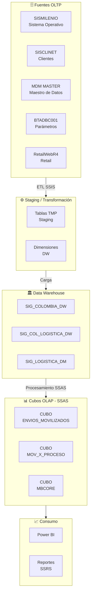

---

## Bases de Datos involucradas

| Alias | Servidor | Base de Datos | Rol |
|-------|----------|---------------|-----|
| `SIG_COLOMBIA_DW` | `SERV-DBI01` | `SIG_COLOMBIA_DW` | DW Principal Colombia |
| `SIG_COL_LOGISTICA_DW` | `SERV-DBI01` | `SIG_COL_LOGISTICA_DW` | DW Logística |
| `SIG_LOGISTICA_DM` | `SERV-DBI01` | `SIG_LOGISTICA_DM` | Data Mart Logística |
| `PARAMETROS` | `LSTSSDGN` / `BTADBC001` | `PARAMETROS` | Parámetros prefacturación |
| `SISCLINET` | `SERV-SCNDB_SQL05` | `SISCliNet` | Maestro de clientes |
| `MDM_MASTER` | `SERV-MDM_MASTER` | `PARAMETROS_MDM` | Master Data Management |
| `Mece_Logistico` | `MEPVSVWSSDGN01` | `DBDG001` | Mecé Logístico |
| `RetailWebR4` | `LSTSSRET_SQL03` | `RetailWebR4` | Retail |

---

## Proyectos

---

### 1. HU\_PBL\_ENVIOS\_MOVILIZADOS\_GETPV2

**Tipo:** SSIS | **Historia de Usuario:** PBL | **Versión:** GTP V2

#### Descripción

Pipeline ETL que extrae, transforma y carga los **envíos movilizados** desde SISMILENIO hacia el Data Warehouse, incluyendo el tiempo de promesa de entrega, seguimiento de envíos, y la tabla de hechos `FAC_ENVIOS_MOVILIZADOS`. Es el pipeline principal del cubo de Envíos Movilizados.

#### Paquetes SSIS

| # | Paquete | Descripción |
|---|---------|-------------|
| 00 | `00_Maestro_EnviosMovilizados.dtsx` | Paquete maestro — orquesta la ejecución de todos los pasos |
| 00 | `00_Envios_Movilizados.dtsx` | Paquete orquestador alternativo |
| 00 | `00_GTP_V2_EnviosMovim.dtsx` | Orquestador específico para flujo GTP V2 |
| P00 | `P00_CARGAR_DIMENSIONES.dtsx` | Carga y actualiza todas las dimensiones del DW |
| P01 | `P01_SISMILENIO_EXTRAER_ENVIOS_MOVILIZADOS_TMP.dtsx` | Extrae envíos movilizados a tabla temporal desde SISMILENIO |
| P02 | `P02_SISMILENIO_EXTRAER_GUIAS_ENTREG_TIEMPO_PROMESA_RED_OPERATIVA.dtsx` | Extrae guías entregadas con tiempo de promesa v1 |
| P03 | `P03_SISMILENIO_EXTRAER_GUIAS_ENTREG_TIEMPO_PROMESA_RED_OPERATIVA_V2.dtsx` | Extrae guías entregadas con tiempo de promesa v2 |
| P04 | `P04_SISMILENIO_EXTRAER_ENVIOS_MOVILIZADOS_SEGUIMIENTO_ENVIO.dtsx` | Extrae el seguimiento (trazabilidad) de los envíos |
| P05 | `P05_Borrar Tabla FAC_ENVIOS_MOVILIZADOS.dtsx` | Trunca / borra la tabla de hechos antes de recarga |
| P06 | `P06_SISMILENIO_EXTRAER_ENVIOS_MOVILIZADOS_FAC_SP.dtsx` | Llama al SP que carga la tabla de hechos final |
| AUX | `EXTRAER_CLIENTES_MOVIMIENTO.dtsx` | Extrae maestro de clientes con movimiento |
| AUX | `Comparacion_DG_MCP.dtsx` | Compara datos entre fuentes DG y MCP |

#### Flujo de Ejecución

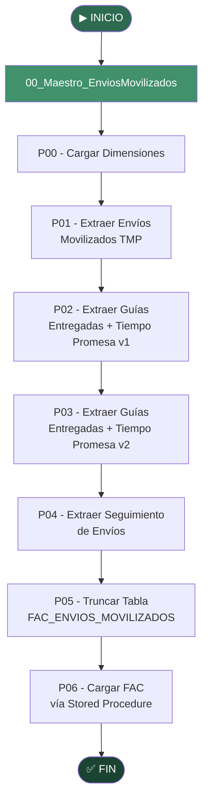

#### Diagrama de Fuentes y Destinos

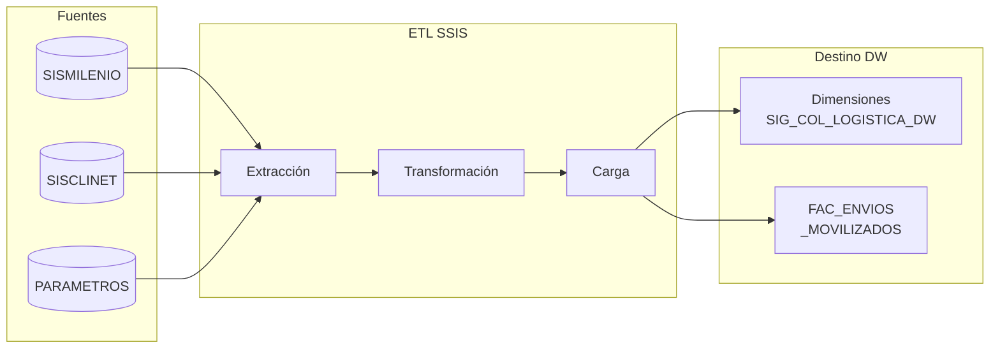

#### Conexiones Configuradas

| Archivo `.conmgr` | Descripción |
|-------------------|-------------|
| `DS_SIG_COLOMBIA_DW.conmgr` | DW Colombia (Dev) |
| `DS_SIG_COL_LOGISTICA_DW.conmgr` | DW Logística (Dev) |
| `DS_SISCLINET_Usrsisclinet.conmgr` | Base de clientes |
| `PRD_LSTSSDGN.conmgr` | Servidor Parámetros (Prod) |
| `PRD_RETAIL_LSTSSRET_SQL03.RetailWebR4.conmgr` | Retail (Prod) |

---

### 2. HU\_RGNFAC-CUBOS-PBI004\_ENVIOS\_MOV

**Tipo:** SSIS | **Historia de Usuario:** RGNFAC | **Código:** PBI004

#### Descripción

Pipeline ETL equivalente al `HU_PBL_ENVIOS_MOVILIZADOS_GETPV2`, adaptado para la historia de usuario **RGNFAC** (Regional de Facturación). Mantiene la misma estructura de paquetes pero con parámetros de proyecto independientes para el ambiente de producción de facturación regional.

#### Paquetes SSIS

| # | Paquete | Descripción |
|---|---------|-------------|
| 00 | `00_Maestro_EnviosMovilizados.dtsx` | Orquestador maestro |
| 00 | `00_GTP_V2_EnviosMovim.dtsx` | Orquestador GTP V2 |
| P00 | `P00_CARGAR_DIMENSIONES.dtsx` | Carga dimensiones |
| P01 | `P01_SISMILENIO_EXTRAER_ENVIOS_MOVILIZADOS_TMP.dtsx` | Extracción a tabla TMP |
| P02 | `P02_SISMILENIO_EXTRAER_GUIAS_ENTREG_TIEMPO_PROMESA_RED_OPERATIVA.dtsx` | Tiempo de promesa v1 |
| P03 | `P03_SISMILENIO_EXTRAER_GUIAS_ENTREG_TIEMPO_PROMESA_RED_OPERATIVA_V2.dtsx` | Tiempo de promesa v2 |
| P04 | `P04_SISMILENIO_EXTRAER_ENVIOS_MOVILIZADOS_SEGUIMIENTO_ENVIO.dtsx` | Seguimiento de envíos |
| P05 | `P05_Borrar Tabla FAC_ENVIOS_MOVILIZADOS.dtsx` | Truncar tabla de hechos |
| P06 | `P06_SISMILENIO_EXTRAER_ENVIOS_MOVILIZADOS_FAC_SP.dtsx` | Carga FAC vía SP |

#### Flujo de Ejecución


> **Diferencia con HU\_PBL:** Este proyecto usa los parámetros de proyecto configurados para el contexto RGNFAC (Regional Facturación), apuntando a servidores de producción específicos de esa región.

---

### 3. HU\_AJCUBO-CUBOS-PBI01-GETP\_PE\_VF

**Tipo:** SSIS (2 soluciones) | **Historia de Usuario:** AJCUBO-CUBOS-PBI01

#### Descripción

Carpeta que agrupa dos soluciones SSIS independientes relacionadas con ajustes al cubo de Envíos Movilizados GTP V2:

---

#### 3a. ENVIOS\_MOV\_GETP\_V2

Pipeline de envíos movilizados con la misma estructura secuencial P00→P06, creado para pruebas y validación de ajustes al cubo GTP V2. Incluye el paquete adicional `Comparacion_DG_MCP.dtsx` para validar diferencias entre fuentes.

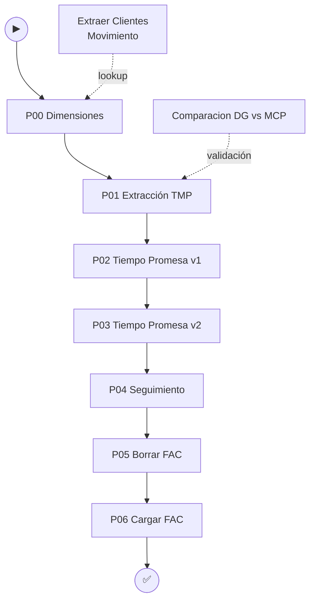

---

#### 3b. MODREC\_LPC\_COD\_ERRORES

Pipeline auxiliar que extrae y actualiza los **códigos de error LPC** (Logística de Primera y Cobro) para la modificación del módulo de recaudo.

| # | Paquete | Descripción |
|---|---------|-------------|
| 00 | `00_llamar_pasos.dtsx` | Orquestador de pasos |
| 01 | `01_EXTRACCION.dtsx` | Extrae los códigos de error desde la fuente |

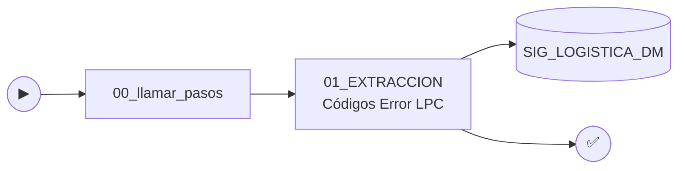

**Conexiones:** `SIG_COLOMBIA_DW`, `SIG_LOGISTICA_DM`, `Mece_Logistico`

---

### 4. CUBO\_SSAS\_ENV\_MOV\_GETP\_V2

**Tipo:** SSAS Multidimensional | **Proyecto:** `.dwproj`

#### Descripción

Cubo **OLAP multidimensional** de Analysis Services que expone los datos de **Envíos Movilizados** para su consumo desde Power BI y otros clientes OLAP. Es el artefacto analítico final que alimentan los pipelines SSIS de envíos movilizados.

#### Estructura del Cubo

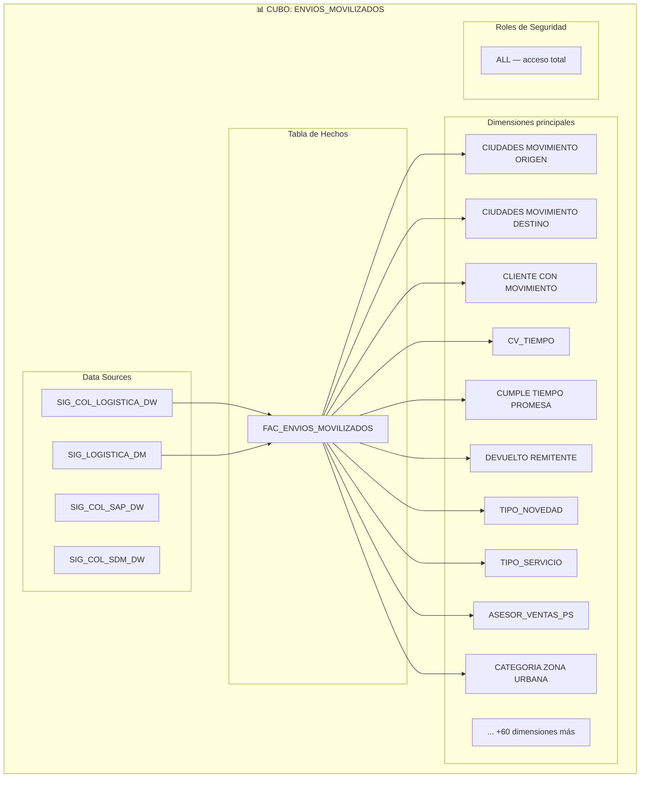

#### Data Sources configurados

| Archivo `.ds` | Base de Datos |
|---------------|---------------|
| `SIG_COL_LOGISTICA_DW.ds` | DW Logística Colombia |
| `SIG_LOGISTICA_DM.ds` | Data Mart Logística |
| `SIG_COL_SAP_DW.ds` | DW SAP Colombia |
| `SIG_COL_SDM_DW.ds` | DW SDM Colombia |

#### Paso a paso — Despliegue del cubo

```
1. Abrir solución CUBO_SSAS_ENV_MOV_GETP_V2.sln en Visual Studio (SSDT)
2. Verificar las conexiones en cada .ds apunten al servidor correcto
3. Ejecutar primero los pipelines SSIS de Envíos Movilizados (Proyectos 1 ó 2)
4. Build → Deploy en SSDT para desplegar al servidor SSAS
5. Procesar el cubo: Process > Process Full en SSMS
6. Validar desde Excel o Power BI conectando al cubo OLAP
```

---

### 5. GM\_GREEN\_MOBILE\_HU\_AJCUBO-CUBOS-PBI02

**Tipo:** SSIS | **Historia de Usuario:** AJCUBO-CUBOS-PBI02

#### Descripción

Pipeline ETL para la carga de datos de operaciones **Green Mobile** — el sistema de distribución y recolección móvil de Servientrega. Extrae datos operativos de SISMILENIO (movimientos de recolección y distribución en dispositivos móviles) y los carga al DW de Logística.

#### Paquetes SSIS

| Paquete | Descripción |
|---------|-------------|
| `SISMILENIO_EXTRAER_GM_RECOLECCION.dtsx` | Extrae datos de recolección desde SISMILENIO |
| `SISMILENIO_EXTRAER_GM_REC_RECHAZOS.dtsx` | Extrae rechazos en la recolección |
| `SISMILENIO_EXTRAER_GM_DISTRIBUCION.dtsx` | Extrae datos de distribución desde SISMILENIO |
| `SISMILENIO_EXTRAER_GM_HORA_DISTRIBUCION.dtsx` | Extrae horas de distribución (granularidad horaria) |
| `EXTRACCION RECOLECCION GM.dtsx` | Orquesta extracción completa de recolección |
| `EXTRACCION DISTRIBUCION GM.dtsx` | Orquesta extracción completa de distribución |
| `TRANSFORMACION RECOLECCION GM.dtsx` | Aplica reglas de negocio a datos de recolección |
| `TRANSFORMACION DISTRIBUCION GM.dtsx` | Aplica reglas de negocio a datos de distribución |
| `CARGA RECOLECCION GM.dtsx` | Carga datos de recolección al DW |
| `CARGA DISTRIBUCION GM.dtsx` | Carga datos de distribución al DW |
| `000REPOBLAR_A_DESARROLLO.dtsx` | Repobla ambiente de desarrollo con datos de producción |

#### Flujo ETL — Recolección y Distribución

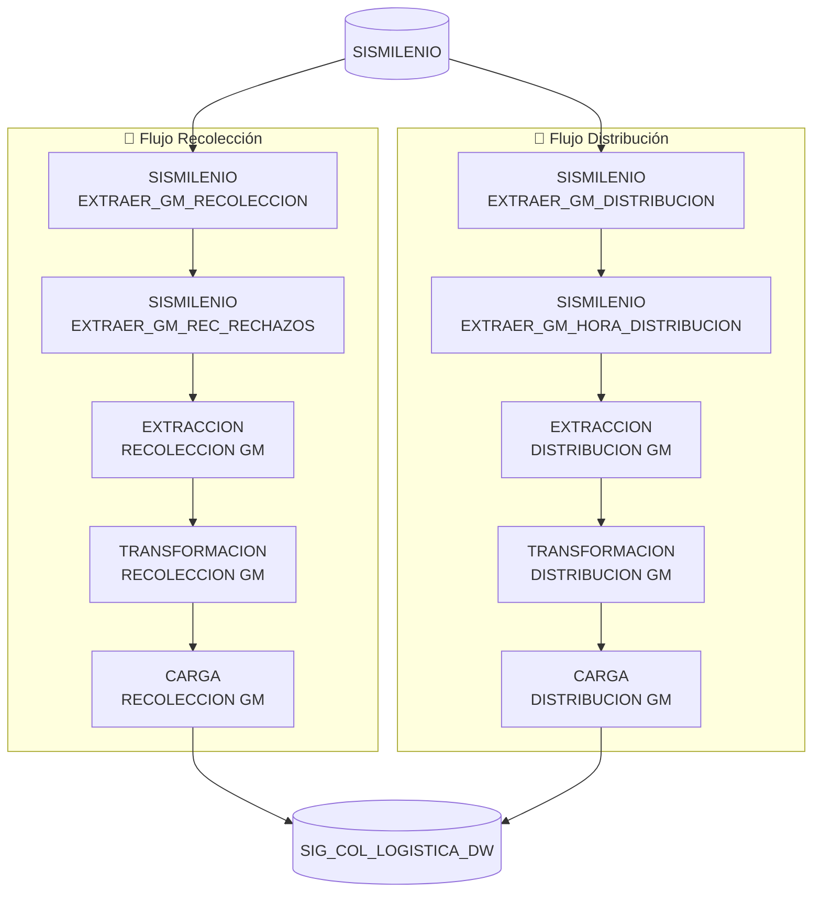

#### Conexiones configuradas

| Archivo `.conmgr` | Descripción |
|-------------------|-------------|
| `MECE_LOGISTICO.conmgr` | Mecé Logístico |
| `PSIG_COLOMBIA_DW.conmgr` | DW Colombia (Prod) |
| `PSIG_COL_LOGISTICA_DW.conmgr` | DW Logística (Prod) |
| `SIG_LOGISTICA_DM.conmgr` | Data Mart Logística |
| `SSISDB.conmgr` | Catálogo SSIS |

---

### 6. MOV\_PROC\_LOG\_VALIDAR\_CATEGORIA\_ZU

**Tipo:** SSIS (2 sub-proyectos) | **Ámbito:** Movimientos por Proceso Logístico

#### Descripción

Pipeline ETL para la carga del modelo analítico de **Movimientos por Proceso Logístico**, validando categorías de **Zona Urbana (ZU)**. Integra datos de múltiples fuentes (SISMILENIO, BTADBC001, SISCLINET, MDM, Retail) para alimentar el cubo de movimientos `MOV_X_PROCESO`.

Este proyecto se divide en dos sub-proyectos:
- **MOV_PROC_LOG_VALIDAR_CATEGORIA_ZU** — Pipeline principal de movimientos
- **PARAMETROS** — Pipeline de dimensiones y parámetros de referencia

#### Paquetes — Pipeline Principal

| Paquete | Descripción |
|---------|-------------|
| `000.dtsx` | Orquestador raíz — arranca todo el flujo |
| `000_Mov_X_Proceso_Log_Vehicu.dtsx` | Orquestador de movimientos por proceso y vehículo |
| `DIMENSIONES.dtsx` | Carga y actualiza todas las dimensiones |
| `EXTRACCION.dtsx` | Extracción incremental de movimientos |
| `EXTRACCION_FULL.dtsx` | Extracción completa (full load) de movimientos |
| `EXTRAER_DIMENSIONES_MECE_LOGISTICO.dtsx` | Extrae dimensiones desde Mecé Logístico |
| `SISMILENIO_EXTRAER_MOV_POR_PROCESO_PRODUCTO.dtsx` | Extrae movimientos por proceso y producto desde SISMILENIO |
| `TRANSFORMACION.dtsx` | Aplica transformaciones y reglas de negocio |
| `PROCESAR_CUBOS_WEEKEND_MOXP.dtsx` | Procesa el cubo SSAS MOX en fin de semana |

#### Paquetes — Sub-proyecto PARAMETROS

| Paquete | Descripción |
|---------|-------------|
| `EXTRAER_BTADBC001.dtsx` | Extrae parámetros desde BTADBC001 |
| `EXTRAER_CIUDADES_MOVIMIENTOS.dtsx` | Extrae maestro de ciudades de movimientos |
| `EXTRAER_CIUDADES_REGIONALES_PAIS.dtsx` | Extrae ciudades por regional y país |
| `EXTRAER_SISCLINET.dtsx` | Extrae maestro de clientes desde SISCliNet |
| `EXTRAER_MDMMASTER.dtsx` | Extrae datos maestros desde MDM |
| `EXTRAER_RECAUDO.dtsx` | Extrae datos de recaudo |
| `EXTRAER_LSTSSFACE.dtsx` | Extrae datos de facturación electrónica |
| `EXTRAER_PARAMETROS_PREFACTURACION_MDM.dtsx` | Extrae parámetros de prefacturación desde MDM |
| `CREAR_DIMENSIONES.dtsx` | Crea y puebla las tablas de dimensiones |

#### Flujo de Ejecución Completo

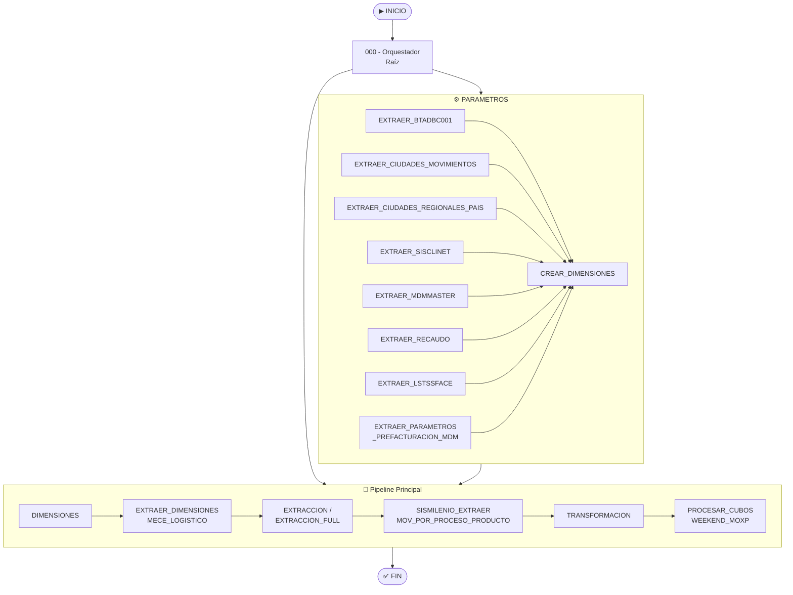

#### Mapa de Fuentes

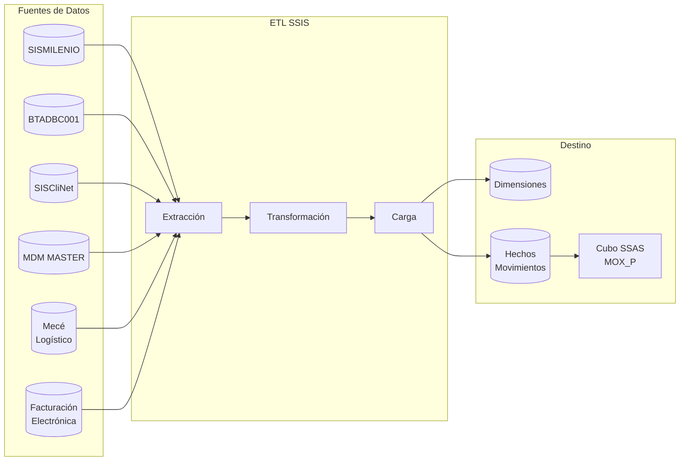

#### Conexiones configuradas

| Archivo `.conmgr` | Descripción |
|-------------------|-------------|
| `SERV-DBI01.SIG_COLOMBIA_DW.conmgr` | DW Colombia |
| `SERV-DBI01.SIG_COL_LOGISTICA_DW.conmgr` | DW Logística |
| `SERV-BTADBC001.conmgr` | Parámetros prefacturación |
| `SERV-SCNDB_SQL05.SISCliNet.conmgr` | Clientes |
| `SERV-MDM_MASTER.PARAMETROS.conmgr` | MDM Master |
| `CIL Provincias.conmgr` | CIL Provincias |

---

### 7. MODELO\_MPCCO\_CONTROL\_CIERRE\_OP\_VEJEZ\_BODEGAS

**Tipo:** SSIS | **Ámbito:** Control de Cierre Operativo

#### Descripción

Pipeline ETL del modelo **MPCCO** (Modelo de Control de Cierre Operativo) que gestiona el **control de vejez de bodegas** y cierre de operaciones. Extrae, integra y carga datos relacionados con el estado operativo de bodegas, envejecimiento de paquetes y control de cierre de operaciones.

#### Paquetes SSIS

| # | Paquete | Descripción |
|---|---------|-------------|
| 00 | `00_LLAMAR_PAQUETES.dtsx` | Paquete maestro — llama secuencialmente los demás |
| 01 | `01_EXTRACCION_E_INTEGRACION.dtsx` | Extrae datos de múltiples fuentes e integra en staging |
| 02 | `02_TRANSFORMACION.dtsx` | Aplica reglas de negocio y transformaciones |
| 03 | `03_CARGA.dtsx` | Carga los datos transformados al DW |

#### Flujo de Ejecución

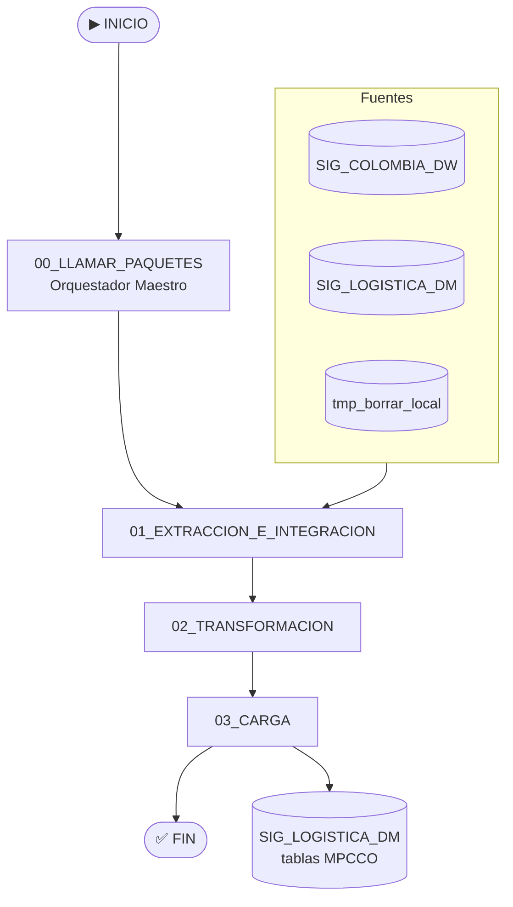

#### Conexiones configuradas

| Archivo `.conmgr` | Descripción |
|-------------------|-------------|
| `D_SERV-DBI01.SIG_COLOMBIA_DW.conmgr` | DW Colombia |
| `D_SERV-DBI01.SIG_LOGISTICA_DM.conmgr` | Data Mart Logística |
| `MEPVSVWSSDGN01_DBDG001.tmp_borrar_local.conmgr` | Staging temporal |

#### Parámetros de Proyecto

El archivo `Project.params` contiene los parámetros de ambiente (servidor, rutas, fechas de corte) que se inyectan en tiempo de ejecución por el SQL Server Agent o el Catálogo SSIS.

---

### 8. GUIA\_MASIVA\_NUEVOS\_CAMPOS

**Tipo:** SSIS | **Ámbito:** Guía Masiva — Nuevos Campos

#### Descripción

Pipeline ETL diseñado para incorporar **nuevos campos** al modelo de **Guía Masiva** — el proceso de carga masiva de guías de envío. Realiza la transformación y carga de los campos extendidos requeridos por el modelo dimensional actualizado.

#### Paquetes SSIS

| Paquete | Descripción |
|---------|-------------|
| `TRANSFORMACION.dtsx` | Extrae y transforma los datos con los nuevos campos |
| `CARGAR.dtsx` | Carga el resultado transformado al DW |
| `BK20261023_TRANSFORMACION.dtsx` | Backup del paquete de transformación (23-Oct-2026) |
| `BK20261023_CARGAR.dtsx` | Backup del paquete de carga (23-Oct-2026) |

#### Flujo de Ejecución

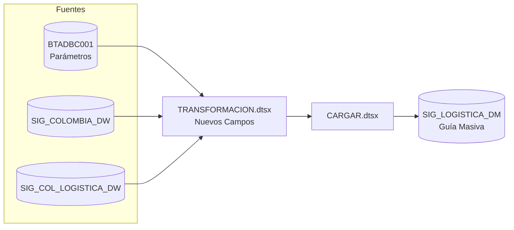

#### Conexiones configuradas

| Archivo `.conmgr` | Descripción |
|-------------------|-------------|
| `SERV-BTADBC001.conmgr` | Parámetros prefacturación |
| `SIG_COLOMBIA_DW.conmgr` | DW Colombia |
| `SIG_COL_LOGISTICA_DW.conmgr` | DW Logística |
| `SIG_LOGISTICA_DM.conmgr` | Data Mart Logística |
| `BOPVSVWSSDGN02_DBDG001.tmp_borrar_local.conmgr` | Staging temporal |

> **Nota:** Los archivos `BK20261023_*.dtsx` son respaldos de los paquetes originales antes de la modificación del 23 de octubre de 2026. Se conservan para rollback.

---

### 9. REBUILD\_MODELO\_MBCORE\_REZAGOS\_COMPENSACION

**Tipo:** SSIS | **Ámbito:** Rezagos y Compensación

#### Descripción

Pipeline ETL que **reconstruye el modelo MBCORE** de rezagos y compensación. MBCORE es el modelo de datos para el seguimiento de paquetes rezagados y el cálculo de compensaciones económicas generadas por incumplimientos en los tiempos de entrega.

#### Paquetes SSIS

| Paquete | Descripción |
|---------|-------------|
| `01_MBCORE_TRANSFORMACION.dtsx` | Extrae y transforma los datos de rezagos y compensaciones |
| `02_MBCORE_CARGAR.dtsx` | Carga el modelo MBCORE reconstruido al DW |
| `BK20261016_01_MBCORE_TRANSFORMACION.dtsx` | Backup de transformación (16-Oct-2026) |

#### Flujo de Ejecución

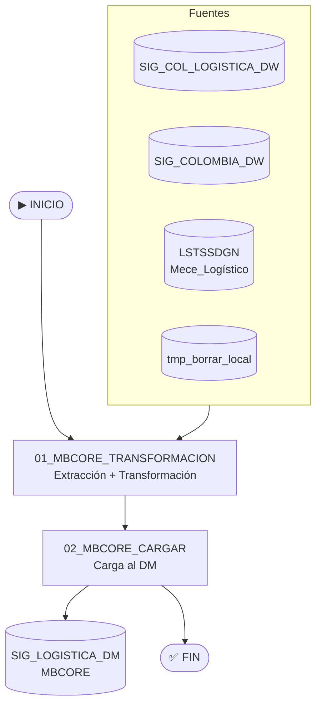

#### Modelo Conceptual MBCORE

```
┌─────────────────────────────────────────────────────────┐
│                   MODELO MBCORE                         │
│                                                         │
│  Rezago = paquete que supera el tiempo de promesa       │
│                                                         │
│  Compensación = valor económico calculado por rezago    │
│                 según acuerdo con el cliente            │
│                                                         │
│  FAC_REZAGOS_COMPENSACION                               │
│  ├── DIM_CLIENTE                                        │
│  ├── DIM_CIUDAD_ORIGEN                                  │
│  ├── DIM_CIUDAD_DESTINO                                 │
│  ├── DIM_TIPO_SERVICIO                                  │
│  ├── DIM_FECHA                                          │
│  ├── VALOR_COMPENSACION                                 │
│  ├── DIAS_REZAGO                                        │
│  └── TIPO_INCUMPLIMIENTO                                │
└─────────────────────────────────────────────────────────┘
```

#### Conexiones configuradas

| Archivo `.conmgr` | Descripción |
|-------------------|-------------|
| `SIG_COLOMBIA_DW.conmgr` | DW Colombia |
| `SIG_COL_LOGISTICA_DW.conmgr` | DW Logística |
| `LSTSSDGN.Mece_Logistico.conmgr` | Mecé Logístico |
| `SERV-BTADBC001.conmgr` | Parámetros prefacturación |
| `P_SIG_LOGISTICA_DM.conmgr` | Data Mart Logística (Prod) |

> **Nota:** `BK20261016_01_MBCORE_TRANSFORMACION.dtsx` es el respaldo antes del rebuild del 16 de octubre de 2026.

---

### 10. DW\_ACTUALIZACION\_TABLAS\_LOG

**Tipo:** SSIS | **Ámbito:** Actualización de Log en DW

#### Descripción

Pipeline SSIS que actualiza las **tablas de seguimiento (log)** en el Data Warehouse. Su paquete principal extrae el seguimiento completo de envíos desde SISMILENIO y lo actualiza en la tabla de log del DW, garantizando la trazabilidad de cada evento en la cadena logística.

#### Paquetes SSIS

| Paquete | Descripción |
|---------|-------------|
| `01_SEGUIMIENTO_ENVIO.dtsx` | Extrae y actualiza el log de seguimiento de envíos en el DW |

#### Flujo de Ejecución

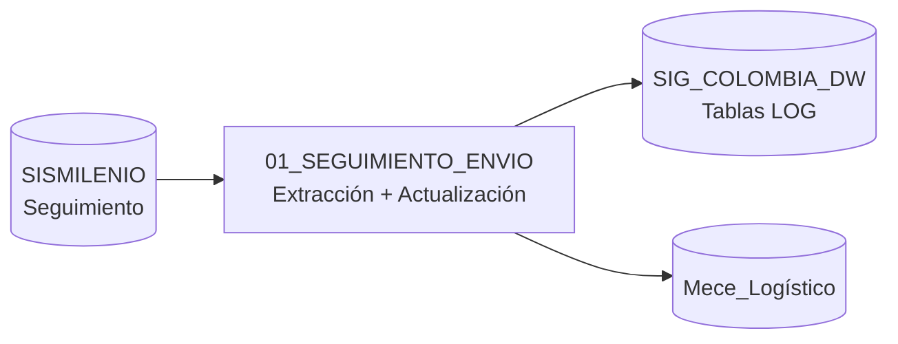

#### Conexiones configuradas

| Archivo `.conmgr` | Descripción |
|-------------------|-------------|
| `MEPVSVWSSDGN01_DBDG001.Mece_Logistico.conmgr` | Mecé Logístico |
| `SERV-DBI01.SIG_COLOMBIA_DW.conmgr` | DW Colombia |

---

## Convenciones y Estándares

### Nomenclatura de paquetes

| Prefijo | Significado |
|---------|-------------|
| `P00_` | Carga de dimensiones |
| `P01_` | Primera extracción (tabla TMP) |
| `P02_` / `P03_` | Extracción de guías/hechos adicionales |
| `P04_` | Extracción de seguimiento/trazabilidad |
| `P05_` | Limpieza / truncado de tabla destino |
| `P06_` | Carga final a tabla de hechos (FAC) |
| `00_` | Orquestador / paquete maestro |
| `BK{fecha}_` | Backup de un paquete antes de modificación |
| `SISMILENIO_EXTRAER_` | Extracción directa desde SISMILENIO |

### Ambientes

| Prefijo conexión | Ambiente |
|-----------------|----------|
| `DS_` | Development / staging |
| `PRD_` | Production |
| `D_` | Development |
| `P_` | Production |
| Sin prefijo | Genérico / configurable por parámetro |

### Estructura de proyecto SSIS estándar

```
PROYECTO/
├── PROYECTO.sln                  ← Solución Visual Studio
└── PROYECTO/
    ├── PROYECTO.dtproj           ← Proyecto SSIS
    ├── PROYECTO.database         ← Metadatos de BD
    ├── Project.params            ← Parámetros del proyecto
    ├── *.conmgr                  ← Connection Managers
    ├── *.dtsx                    ← Paquetes SSIS
    ├── bin/                      ← Binarios compilados
    └── obj/Development/          ← Artefactos de compilación
```

---

## Configuración de Conexiones

Los connection managers (`.conmgr`) almacenan la configuración de conexión de cada ambiente. Para cambiar entre Dev y Prod se utilizan los **parámetros del proyecto** (`Project.params`) que sobreescriben las cadenas de conexión en tiempo de ejecución.

### Configuración recomendada en Catálogo SSIS

```
SSISDB/
└── SERVIENTREGA/
    ├── ENVIOS_MOVILIZADOS/       ← Carpeta del proyecto
    │   └── HU_PBL_ENVIOS_MOVILIZADOS_GETPV2/
    ├── GREEN_MOBILE/
    │   └── GM_GREEN_MOBILE/
    └── MOV_PROCESO/
        └── MOV_PROC_LOG_VALIDAR_CATEGORIA_ZU/
```

### Variables de Entorno recomendadas

| Variable | Descripción |
|----------|-------------|
| `CM.SIG_COL_LOGISTICA_DW.ConnectionString` | Cadena de conexión DW Logística |
| `CM.SIG_COLOMBIA_DW.ConnectionString` | Cadena de conexión DW Colombia |
| `CM.SISCLINET.ConnectionString` | Cadena de conexión SISCliNet |
| `CM.PARAMETROS.ConnectionString` | Cadena de conexión Parámetros |

---

*Última actualización: Noviembre 2026 — Autor: John Cruz*
